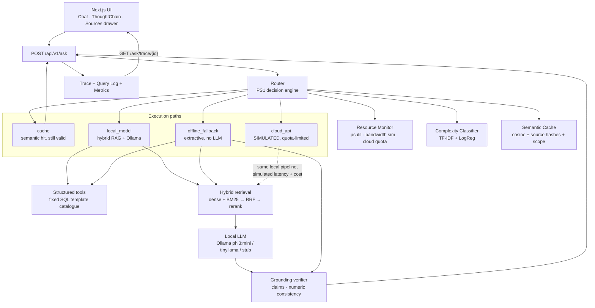

# Architecture

AMYPO Campus Assistant is a fully offline question-answering system with an
integrated low-cost request router (PS1) and a deterministic placement engine.
Nothing in the request path opens an outbound network connection; the
`cloud_api` route is a local simulator.

## Request flow

## Why each route exists

| Route | Meaning | Cheapest when |
|---|---|---|
| `cache` | Semantic cache hit on a still-valid answer | The same question was answered and its source records have not changed |
| `local_model` | Full RAG: hybrid retrieval + local LLM + grounding | RAM is healthy and complexity is low/medium |
| `offline_fallback` | Extractive answer (best passage or SQL row), no LLM | RAM is low or the model is slow/unhealthy |
| `cloud_api` | **Simulated** quota-limited path | Complexity is high, bandwidth is fine, quota remains |

Numbers are never generated by the LLM. Anything numeric comes from the
parameterised SQL template catalogue and is then phrased, never computed, by
the model.

## Access control

Access scope is enforced in the retriever, not in the prompt. A student may only
retrieve `student:<own_id>` records plus `public` documents; staff retrieve
everything. The semantic cache key includes the access scope, so a cached staff
answer is never served to a student.

## Storage

- **SQLite** — structured campus data, chunk text and metadata, semantic cache,
  query log, router decisions, resource samples, eval runs.
- **Embeddings** — float32 vectors persisted on the `chunks` rows, with a FAISS
  index for fast search when `faiss-cpu` is installed and a numpy cosine
  fallback when it is not.

## Graceful degradation

Three tiers of local degradation before anything is refused:

1. `phi3:mini` → `tinyllama` when RAM drops (auto-downgrade).
2. LLM unavailable or too slow → extractive `offline_fallback` (flagged
   `degraded: true`).
3. Evidence insufficient or unsupported → abstention with the closest records.

## Phase map

| Phase | Deliverable |
|---|---|
| 1 | Contracts, skeleton, schema, health |
| 2 | Synthetic data, benchmark set, ingestion |
| 3 | Hybrid retrieval, reranking, access control, retrieval eval |
| 4 | Grounded generation, SQL tools, verifier, `/ask` trace |
| 5 | PS1 router, monitor, cache, simulator, metrics |
| 6 | Placement eligibility, matching, skill gaps, what-if |
| 7 | Frontend: chat, thought chain, sources, dashboard, placement |
