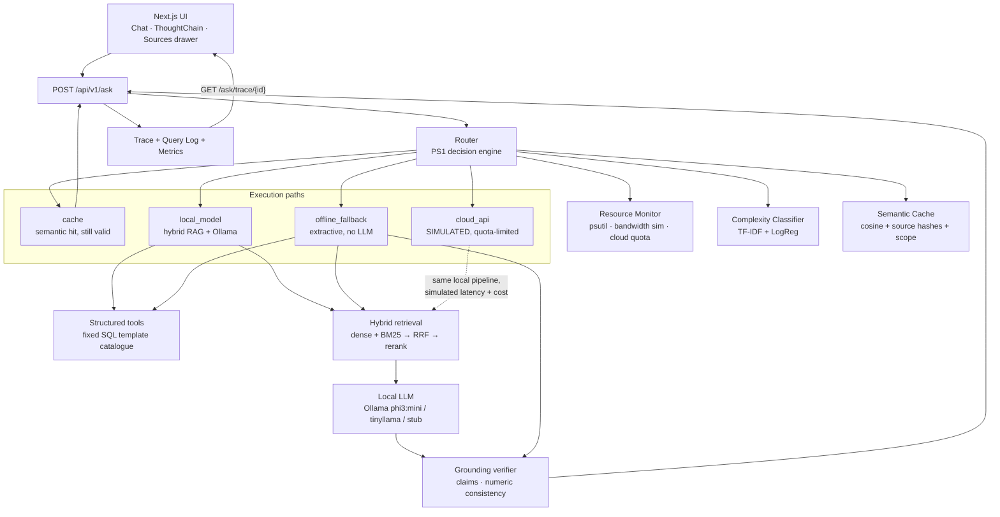

# Architecture

AMYPO Campus Assistant is a fully offline question-answering system with an
integrated low-cost request router (PS1) and a deterministic placement engine.
Nothing in the request path opens an outbound network connection; the
`cloud_api` route is a local simulator.

## Request flow

## Why each route exists

| Route | Meaning | Cheapest when |
|---|---|---|
| `cache` | Semantic cache hit on a still-valid answer | The same question was answered and its source records have not changed |
| `local_model` | Full RAG: hybrid retrieval + local LLM + grounding | RAM is healthy and complexity is low/medium |
| `offline_fallback` | Extractive answer (best passage or SQL row), no LLM | RAM is low or the model is slow/unhealthy |
| `cloud_api` | **Simulated** quota-limited path | Complexity is high, bandwidth is fine, quota remains |

Numbers are never generated by the LLM. Anything numeric comes from the
parameterised SQL template catalogue and is then phrased, never computed, by
the model.

## Access control

Access scope is enforced in the retriever, not in the prompt. A student may only
retrieve `student:<own_id>` records plus `public` documents; staff retrieve
everything. The semantic cache key includes the access scope, so a cached staff
answer is never served to a student.

## Storage (MySQL / FAISS)

Data is split by role, and the split is strict:

- **MySQL 8** (via SQLAlchemy + PyMySQL) — everything exact: grades, attendance,
  schedules, skills, company criteria, and the chunk **text, metadata and
  `access_scope`** behind every citation. It also holds the semantic cache, query
  log, router decisions, resource samples and eval runs. Tuned to ~256 MB of
  buffer pool (`db/my.cnf`).
- **FAISS** — embedding vectors only. Each vector id maps back to a
  `chunks.record_id`; text and metadata are always read from MySQL, so a
  citation can never drift from the data it points at. Without `faiss-cpu`, the
  same vectors are searched with a numpy cosine fallback.
- **BM25 (`rank_bm25`)** — lexical ranking over the same chunk texts.

Numbers and eligibility come from parameterised SQL templates and the placement
engine, never the LLM; free text (policies, FAQs, course content) comes from
retrieval over MySQL-backed chunks.

## Placement engine (Phase 6)

Eligibility is decided, not predicted. `app/placement/rules.py` evaluates
deterministic per-criterion comparisons (CGPA/attendance/projects/communication
floors, a backlogs ceiling, an allowed-departments list, required vs preferred
skill levels) and reports every failing criterion by name. Students who pass
are ranked by `suitability.py` — a weighted blend of skill match, project
relevance, performance trend, coding and communication, with per-role weights
read from `company_roles.weights` and renormalised. Suitability only orders
students the rules already accepted, so a soft score can never admit someone
the criteria reject.

- **Skill gaps** (`gaps.py`) report each shortfall with severity
  (blocking/weak/ok) and an ordered learning path whose suggestions cite real
  catalogue records (`doc:course-manual-*` chunks, falling back to
  `db:skills:<id>`).
- **What-if** re-runs eligibility with overrides (CGPA, skill levels, …) and
  reports which roles open up or close; nothing is persisted.
- **Privacy**: a student caller sees only their own record; cohort queries are
  staff-only and every one is written to `cohort_queries` for audit.
- **Fairness**: `fairness.py` holds the protected-attribute list; the feature
  set used for suitability is checked against it at import time.
- **/ask integration**: placement intents are answered by
  `placement/answers.py`, which phrases the engine's results into short,
  per-fact sentences with `[Sn]` citations and hands its own evidence to the
  grounding verifier, so every number in the answer is checked against the
  record it came from. Suitability scores never appear in the prose.

## Graceful degradation

Three tiers of local degradation before anything is refused, selected per
request by `LLMClient.select_model()` from the *available* host RAM:

1. `phi3:mini` while RAM stays above `llm_downgrade_ram_mb` (default 1400 MB).
2. `tinyllama` when RAM falls below `llm_downgrade_ram_mb` — but only if that
   model is actually pulled; if it is not, the request stays on tier 1 rather
   than downgrading to something that would fail. Reported as
   `model_tier: "downgraded"` on the response.
3. RAM at or below `ram_floor_mb` (default 900 MB), the LLM unavailable, or
   every attempt failed → extractive `offline_fallback`, flagged
   `degraded: true` and `model_tier: "extractive"`.

Evidence insufficient or unsupported is separate from resource degradation: it
abstains with the closest records and a clarifying question.

## Phase map

| Phase | Deliverable |
|---|---|
| 1 | Contracts, skeleton, schema, health |
| 2 | Synthetic data, benchmark set, ingestion |
| 3 | Hybrid retrieval, reranking, access control, retrieval eval |
| 4 | Grounded generation, SQL tools, verifier, `/ask` trace |
| 5 | PS1 router, monitor, cache, simulator, metrics |
| 6 | Placement eligibility, matching, skill gaps, what-if |
| 7 | Frontend: chat, thought chain, sources, dashboard, placement |
| 9 | Evaluation harness: ablations, sweeps, scenarios, load test, report |

## Evaluation (Phase 9)

`app.eval.harness.run_harness()` replays the 168-question benchmark through the
real `AskPipeline` and the real `RouterEngine` — no mocks — and derives every
number the report needs from that one pass:

* **answers**: accuracy (gold citation + hard number gate), groundedness,
  citation validity against the `chunks` table, hallucination and abstention
  rates, per-route latency;
* **ablations**: dense / BM25 / hybrid / hybrid+rerank, plus the same items
  re-run with `verifier_threshold = 0` (gate off) so the delta is exactly what
  the grounding gate buys;
* **sweeps**: verifier confidence is re-derived offline from the gate-off pass
  (`abstained = confidence < t`), cache cosine from nearest-other-question
  similarity, RAM floor from logged resource samples plus live `decide()` calls;
* **scenarios**: the six named failure modes (RAM crash, Ollama down, quota,
  offline, bandwidth) asserted against expected routing behaviour;
* **load test**: 20 concurrent users through `decide` + `answer` against the
  shared MySQL pool, reporting throughput, p95 and the p95/p50 queueing ratio.

The harness writes nothing to `query_log`/`router_decisions` and disables
resource-sample persistence while scenarios run, so an evaluation never
pollutes the demo data. `scripts/evaluate.py` (the `make eval` target) adds the
load test and writes `docs/eval/report.{json,html}`; `POST /api/v1/eval/run`
runs the same harness for the frontend's Evaluation page.
